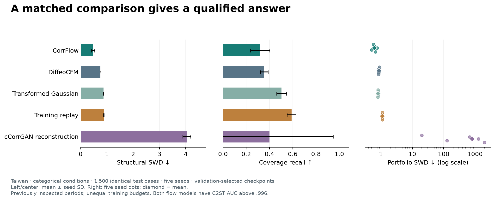

# CorrFlow


Geometry-aware flow matching for positive-definite correlation matrices.
Research software · **0.1.0rc2**.

CorrFlow learns distributions of estimated correlation matrices in generalized
Fisher coordinates. The inverse enforces positive definiteness and unit diagonal;
the graph vector field respects simultaneous row/column permutations. These
properties do not guarantee financial realism, forecasting, or size transfer.

The [model cards](docs/model_cards.md) distinguish the financial model, fixed-atlas
extension and adapted DiffeoCFM, including their measured results and limits.

## Start on CPU

Use Python 3.12 or 3.13. The exact compatible CorrBench revision is installed
from `requirements-benchmark.txt`; no sibling checkout or real dataset is needed
for this example once the coordinated repositories are public.

```bash
git clone https://github.com/gautiermarti/CorrFlow.git corrflow
cd corrflow
python3.12 -m venv .venv
source .venv/bin/activate
python -m pip install --upgrade pip
python -m pip install torch --index-url https://download.pytorch.org/whl/cpu
python -m pip install -r requirements-benchmark.txt .
python examples/generate_and_validate.py
```

On Windows, activate with `.venv\Scripts\Activate.ps1` in PowerShell. For GPU
training, install the PyTorch build appropriate to your CUDA environment.
No PyPI publication is currently claimed. Configurations, examples and tutorials
live in the source checkout; the wheel provides importable APIs and commands.

The example uses a small untrained network to demonstrate geometry and the API.
It is not a financial model checkpoint. Trained checkpoint distribution follows
baseline validation and the versioned paper release.

The [three runnable tutorials](tutorials/README.md) provide a CPU geometry lesson,
sampling/evaluation with a pretrained synthetic six-variable model, and exact
aggregation of the complete financial per-seed table. The synthetic checkpoint
and data are teaching assets; they are separate from empirical paper models. Run the pretrained CPU example:

```bash
cd tutorials
python 01_geometry.py
python 02_generate.py
python 03_reproduce_table.py
cd ..
```

The first two lessons use synthetic data; the third recomputes a stored results
table and does not retrain the financial models. For notebooks, install
`.[notebooks]` and select this virtual environment's kernel.

## Reproduce from returns

Use CorrBench to construct the dated return-derived dataset and its GFT caches.
All competing generators must use the same date/asset windows and test cases.

```bash
corrflow-train --data /path/to/taiwan --config configs/flow_small.yaml \
  --seed 1701 --output artifacts/run
corrflow-evaluate --data /path/to/taiwan --checkpoint artifacts/run/best.pt \
  --weights raw --steps 25 --per-class 500 --seed 2027 \
  --output artifacts/evaluation.json
```

Use `--device cpu` for small functional runs. Paper comparisons require five
training seeds, common conditions and metrics, and the exact published protocol.
Geometry, matrix construction, repair, and metrics are imported from the pinned
CorrBench package; there is no separate copy of the evaluation implementation.

The repository also includes matched GFT diffusion, the image-DDPM control,
dense-network ablations, and computational scaling commands. Inspect each
command with `--help` or use `python -m corrflow.cli.<module>`.

A categorical DiffeoCFM adapter preserves the original full class-wise Gaussian
prior and accepts explicit training/validation splits. Install `.[diffeocfm]`;
see the [protocol and commands](docs/diffeocfm_protocol.md). Component parity is
verified against pinned upstream source. The completed five-seed categorical
Taiwan comparison is recorded in
[CorrBench's audited results](https://github.com/gautiermarti/CorrBench/blob/main/docs/matched_taiwan_results.md).

## Evidence and limitations

The Taiwan case study improves aggregate structural distances while replay
retains better local coverage. Japan does not show universal superiority over
replay; its source-use/publication permission remains unresolved under the
competition rules. See [the source review](https://github.com/gautiermarti/CorrBench/blob/main/docs/jpx_rules_review_20261006.md). Running at a new matrix size does not establish learned size transfer or
projective consistency. These findings remain explicit limitations of this release.

In the additional categorical study, validation-selected CorrFlow structural
SWD is .471 ± .062 versus .751 ± .019 for DiffeoCFM on identical 1,500 test cases.
CorrFlow also has lower portfolio distance; DiffeoCFM has slightly higher recall.
Both remain readily distinguishable from real data, and final weights reverse
the structural ranking. The 20/200-epoch budgets are not equal compute, and these
historical periods were already inspected. The full five-seed categorical cCorrGAN
reconstruction is now included: structural SWD 4.039 ± .154 after repair, zero
measured precision and large portfolio distances. Original GAN training fidelity
remains unestablished.



The repository also supports a node-identity extension and anonymous-node
ablation for ABIDE, plus the categorical weather pilot. The initial brain
augmentation experiment establishes no gain over real-only training. The weather
DiffeoCFM experiment does not beat replay or conditional means on aggregate
variance. These are research pilots, not clinical or forecast systems; their
data construction and task protocols live in CorrBench.

Both the NeurReps paper and extended arXiv version will cite the public GitHub
repositories and compatible release versions. See [release criteria](docs/release_contract.md).

## Development, versions and citation

For editable development with a sibling benchmark checkout:

```bash
python -m pip install -e ../corrbench -e '.[dev,diffeocfm]'
python -m pytest -q
ruff check .
python -m build
```

Use the compatible tagged versions and benchmark pin together. See
[CONTRIBUTING.md](CONTRIBUTING.md) for setup, bug reports and scientific evidence,
[CHANGELOG.md](CHANGELOG.md) for release changes, and [CITATION.cff](CITATION.cff)
for software citation metadata. [SECURITY.md](SECURITY.md) covers checkpoints and
source-data handling. The MIT software license does not grant rights to the
separately obtained research inputs.
